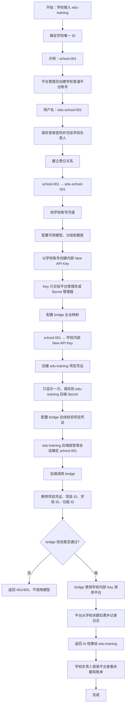

# edu-training 学校 AI 账号分配流程

本文用 `edu-training` 举例，说明平台管理员如何给学校分配 AI 账号，并让学校通过项目使用 AI 能力。

## 参数来源说明

这些值不是都自己编的，来源如下：

| 参数 | 从哪里获得 |
| --- | --- |
| `EDU_TRAINING_BRIDGE_PROJECT_ID` | 平台管理员登记的项目 ID，固定为 `edu-training` |
| `EDU_TRAINING_BRIDGE_PROJECT_KEY` | 平台管理员通过项目凭证 API 创建后返回，只显示一次 |
| `EDU_TRAINING_BRIDGE_CREDENTIAL_VERIFY_URL` | 同一个 Docker Compose 网络直接使用固定地址 |
| `school-001` | 从 `edu-training` 学校表取得的学校唯一 ID |
| `school-001` 后面的 Key | 平台管理员登录该学校平台账号，在 `/keys` 创建内部 New API Key |

### 1. 项目 ID

这个值已经确定：

```ini
EDU_TRAINING_BRIDGE_PROJECT_ID=edu-training
```

它不是学校 ID，而是整个 `edu-training` 项目的 ID。

### 2. 项目凭证

平台管理员调用：

```http
POST /api/project-credentials
```

请求：

```json
{
  "project_id": "edu-training"
}
```

返回的 `data.secret` 就是：

```ini
EDU_TRAINING_BRIDGE_PROJECT_KEY=<平台签发的项目凭证>
```

这个凭证只交给 `edu-training` 后端和 bridge 管理员，不能放到前端。

### 3. 凭证校验地址

如果 bridge 和 `new-api` 在同一个 Docker Compose 网络，直接使用：

```ini
EDU_TRAINING_BRIDGE_CREDENTIAL_VERIFY_URL=http://new-api:3000/api/project-credentials/verify
```

这个地址通常不需要你去找。

如果正式环境中 bridge 和 AI 平台分开部署，应使用 AI 平台自己的 HTTPS 域名，例如：

```ini
EDU_TRAINING_BRIDGE_CREDENTIAL_VERIFY_URL=https://ai-platform.example.com/api/project-credentials/verify
```

不要填写 `edu-training` 项目域名，例如 `school.fengxuan.cn`，除非该域名实际反向代理到了 AI 平台的校验接口。正式环境通常不直接暴露容器端口 `3000`，而是通过反向代理使用 HTTPS；该地址必须能从 bridge 所在服务器访问。

### 4. 学校 ID

例如从 `edu-training` 学校表得到：

```text
学校名称：北京市第一实验小学
学校 ID：school-001
```

然后配置：

```ini
school-001=<学校001内部Key>
```

### 5. 学校内部 Key

平台管理员使用学校账号登录：

```text
<PLATFORM_BASE_URL>/keys
```

创建学校专用 Key。最终配置格式：

```ini
EDU_TRAINING_BRIDGE_ENTERPRISE_TOKENS="school-001=<学校001内部Key>
school-002=<学校002内部Key>"
```

注意：

- 每行一个学校；
- 等号左边是学校 ID；
- 等号右边是该学校专用内部 Key；
- 内部 Key 不交给 `edu-training` 开发者或学校普通用户；
- 当前版本由平台管理员手工维护映射。

最简单的分工是：

```text
平台管理员提供：项目凭证、学校内部 Key
edu-training 提供：学校 ID
平台系统固定：项目 ID、校验地址
```

## 一、先记住 4 个账号的区别

| 名称 | 示例 | 谁使用 | 是否给学校普通用户 |
| --- | --- | --- | --- |
| 学校平台账号 | `edu-school-001` | 学校负责人登录充值、账单页面 | 是 |
| 学校企业标识 | `school-001` | `edu-training` 服务端识别扣费主体 | 否 |
| 企业内部 New API Key | `<SCHOOL_A_INTERNAL_KEY>` | bridge 代表学校向平台调用 | 否 |
| `edu-training` 项目凭证 | `<PROJECT_CREDENTIAL>` | `edu-training` 后端调用 bridge | 否 |

学校平台账号可以使用学校 ID 或学校内部编号命名，但不建议直接使用学校名称。学校更名时，账号和企业标识仍保持不变。

## 二、完整流程图



## 三、按顺序照做

### 第 1 步：确定学校 ID

从 `edu-training` 的学校表中取得稳定、唯一、不可随意修改的学校 ID。

```text
学校名称：北京市第一实验小学
学校 ID：school-001
```

不要把学校名称作为系统关联主键，因为学校可能改名，名称也可能重复。

### 第 2 步：创建学校平台账号

平台管理员打开：

```text
<PLATFORM_BASE_URL>/users
```

创建普通用户账号：

```text
用户名：edu-school-001
密码：通过安全渠道单独交给学校负责人
权限：普通用户，不授予平台管理员权限
```

用户名不强制等于学校 ID，但应能稳定对应学校。推荐格式：

```text
edu-<学校ID>
```

谁拥有这个用户名和密码，谁就能登录学校的充值和账单页面。因此密码不能写入 `edu-training` 代码、前端、浏览器配置或项目凭证配置。

### 第 3 步：登记学校与平台账号的关系

平台管理员在项目登记表或管理系统中记录：

| 字段 | 示例 |
| --- | --- |
| 项目 | `edu-training` |
| 学校 ID | `school-001` |
| 平台用户名 | `edu-school-001` |
| 企业标识 | `school-001` |
| 环境 | `production` |
| 状态 | `active` |

这一步的关键是：`edu-training` 请求中的 `school-001` 必须能唯一找到对应的学校平台账号。

### 第 4 步：给学校充值

学校负责人使用平台管理员提供的用户名和密码登录：

```text
<PLATFORM_BASE_URL>/wallet
```

充值完成后，平台余额归属于该学校账号。学校 A 和学校 B 必须使用不同的平台账号，不能共用余额。

### 第 5 步：配置模型和额度

平台管理员根据合作约定配置：

- 允许使用的模型；
- 所属分组，例如 `default`；
- 调用额度或限额；
- 必要的过期时间和 IP 限制。

先用平台账号完成一次模型调用测试，确认模型可用且不会超出学校额度。

### 第 6 步：创建学校内部 New API Key

以学校账号进入：

```text
<PLATFORM_BASE_URL>/keys
```

创建一个仅供 bridge 使用的 Key，例如：

```text
名称：school-001-edu-training-production
```

完整 Key 只保存到平台 Secret 或 bridge 的受控配置中，不交给：

- 学校普通用户；
- `edu-training` 项目开发者；
- 浏览器、移动端或小程序；
- Git 仓库。

### 第 7 步：配置 bridge 的学校映射

当前 POC 使用受控配置登记学校映射。双引号内一行一个学校，换行就是分隔符，不要用逗号连接：

```dotenv
AI_BRIDGE_ENTERPRISE_TOKENS="school-001=<SCHOOL_A_INTERNAL_KEY>
school-002=<SCHOOL_B_INTERNAL_KEY>"
```

含义是：当 `edu-training` 发送 `X-AI-Enterprise-Id: school-001` 时，bridge 使用学校 001 的内部 Key 调用平台。

### 第 8 步：创建 `edu-training` 项目凭证

平台管理员通过[项目凭证管理](项目凭证管理.md)创建项目凭证：

```text
项目 ID：edu-training
环境：production
```

凭证只在创建或轮换时返回一次。平台管理员必须立即把它交给 `edu-training` 后端负责人，并保存到项目后端 Secret。

项目凭证不是学校账号密码，也不是学校内部 New API Key。

### 第 9 步：配置 bridge 在线校验

bridge 使用托管凭证校验：

```dotenv
AI_BRIDGE_PROJECT_ID=edu-training
AI_BRIDGE_CREDENTIAL_VERIFY_URL=http://new-api:3000/api/project-credentials/verify
```

这样项目凭证被禁用或轮换后，后续请求会立即失效。旧 POC 未配置在线校验地址时，不受平台凭证禁用和轮换控制，生产环境应完成切换。

### 第 10 步：`edu-training` 保存项目配置

只在 `edu-training` 后端保存：

```dotenv
AI_PLATFORM_BRIDGE_BASE_URL=<BRIDGE_BASE_URL>
AI_PLATFORM_PROJECT_ID=edu-training
AI_PLATFORM_PROJECT_CREDENTIAL=<PROJECT_CREDENTIAL>
```

`edu-training` 不保存学校内部 New API Key，也不保存平台管理员密码。

### 第 11 步：用户发起 AI 请求

用户登录 `edu-training` 后，项目后端从自己的登录会话、学校权限或租户关系中确定学校 ID。

后端调用 bridge 时携带：

```http
Authorization: Bearer <PROJECT_CREDENTIAL>
X-AI-Project-Id: edu-training
X-AI-Enterprise-Id: school-001
X-AI-Feature: consumption-check
X-Request-Id: <REQUEST_ID>
```

浏览器只调用 `edu-training`，不能直接调用 bridge，也不能提交任意学校 ID 来切换扣费主体。

### 第 12 步：平台扣费并返回结果

bridge 依次检查：

1. 项目凭证是否有效；
2. 项目 ID 是否为 `edu-training`；
3. 学校 ID 是否已登记；
4. 功能和模型是否开放；
5. 学校余额是否足够。

全部通过后，bridge 使用 `school-001` 对应的内部 Key 调用平台。平台从学校 001 的余额扣费，并记录项目、学校、模型和请求号。

### 第 13 步：学校查看余额和账单

学校负责人使用平台分配的用户名和密码登录：

```text
<PLATFORM_BASE_URL>/wallet
<PLATFORM_BASE_URL>/usage-logs/common
```

企业内谁持有该账号密码，谁就能进入充值和账单页面。本期不要求企业内每个用户都拥有平台账号，也不要求免密 SSO。

## 四、增加第二所学校

增加 `school-002` 时，只重复学校级配置：

1. 创建平台账号 `edu-school-002`；
2. 绑定学校 ID `school-002`；
3. 充值并配置模型、分组和额度；
4. 创建学校 002 的内部 New API Key；
5. 增加 bridge 映射 `school-002 → Key 002`；
6. 做一次调用和扣费验收。

不需要为每所学校创建新的 `edu-training` 项目凭证，也不需要重新部署一套 `edu-training`。

```text
edu-training
├── school-001 → edu-school-001 → Key 001 → 学校 001 余额
├── school-002 → edu-school-002 → Key 002 → 学校 002 余额
└── school-003 → edu-school-003 → Key 003 → 学校 003 余额
```

## 五、最终验收清单

- [ ] 学校负责人可以使用平台账号登录充值页面；
- [ ] 学校负责人可以查看本校账单；
- [ ] `edu-training` 用户不能从浏览器看到项目凭证或内部 Key；
- [ ] 学校 001 请求携带 `school-001`；
- [ ] 学校 001 扣费时学校 002 余额不变化；
- [ ] 平台日志能查到 `edu-training`、学校 ID、模型和请求号；
- [ ] 未登记的学校 ID 被拒绝；
- [ ] 轮换项目凭证后旧凭证不能调用；
- [ ] 禁用项目凭证后不能继续调用。

当前实现中，项目凭证管理 API 和 bridge 在线校验已经具备；学校账号创建、充值和学校到内部 Key 的映射仍由平台管理页面与受控配置完成。
